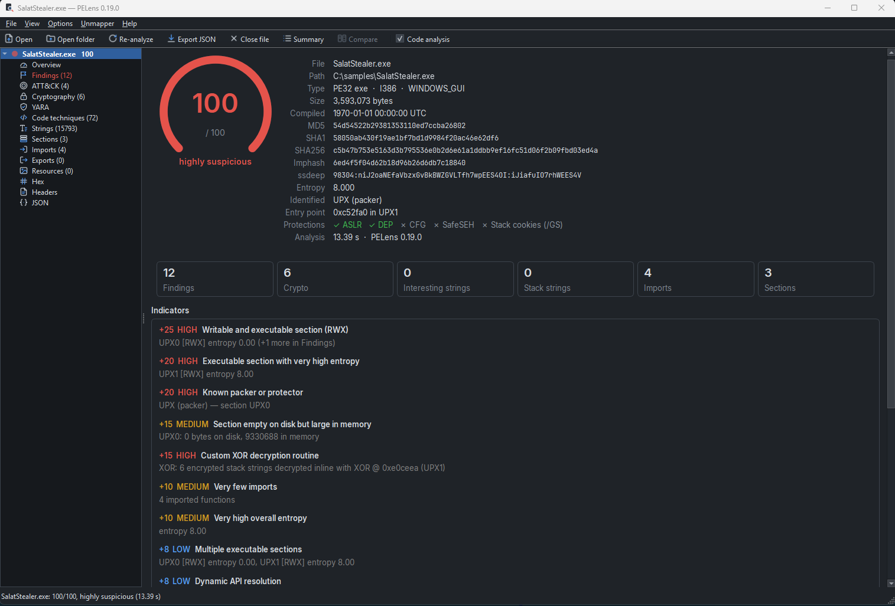
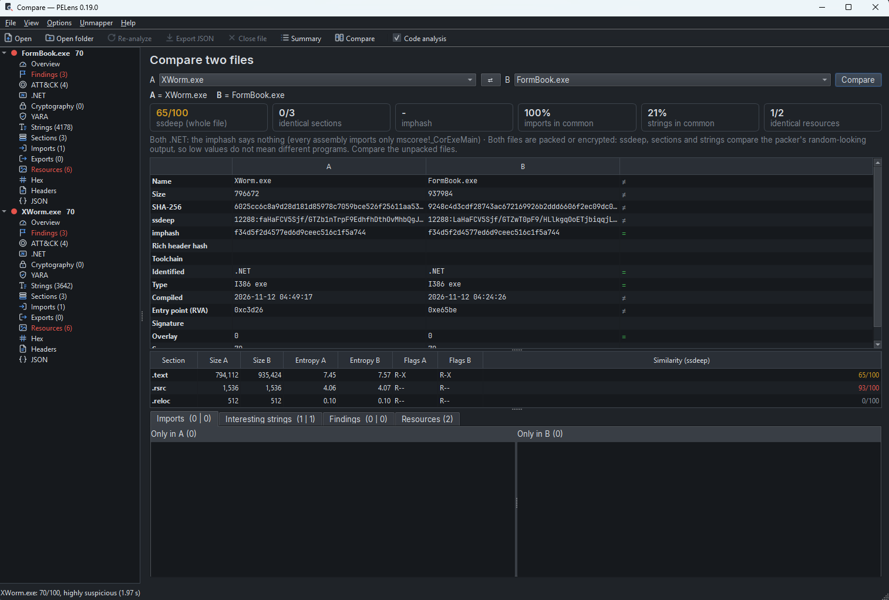
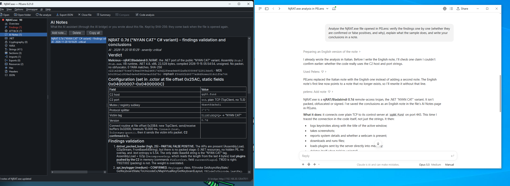

# PELens

**Static PE Analyzer for Malware Triage.** Open an exe or dll and get its structure, what it hides and a
**suspicion score from 0 to 100** with the reasons behind it. Nothing is executed, emulated or decrypted.



## Features

- **PE structure**: headers, sections, imports/exports, resources (with preview), TLS, overlay, protections
  (ASLR, DEP, CFG…), decoded Rich header, verified Authenticode signature
- **Strings** IDA-style, classified (URLs, commands, autorun keys, wallets, anti-VM…), stack strings and Base64
- **Cryptography** recognized without decrypting: AES, ChaCha20, RC4 (custom variants too), DES, Blowfish, TEA,
  hashes, embedded RSA keys, custom Base64, XOR decryption routines
- **Compression and fast hashes**: aPLib, zlib/Deflate, LZMA, LZ4, Zstandard, Windows LZNT1/Xpress APIs;
  MurmurHash2/3, xxHash, SipHash, FNV-1a
- **Loader techniques**: PEB access, API hashing, export parsing, direct syscalls, RWX memory, encrypted payloads
- **Hidden PEs** anywhere in the file, in clear or XOR-encrypted, also inside the pixels of .NET resource images
- **.NET**: APIs by capability, obfuscators, string decryptors in the IL code, steganographic loaders
- **Packers and compilers**: UPX, Themida, VMProtect, NSIS, Inno Setup, Go, Rust, Delphi, PyInstaller…
- **MITRE ATT&CK** techniques for every finding, and your own **YARA** rules
- **Compare two files**: ssdeep of file and sections, imphash, Rich header, imports, resources, Go functions
- **Unmapper**: rebuilds a PE dumped from memory into a file that IDA and PELens read normally
- **HxD-style hex view**, batch analysis of folders with CSV export, JSON and HTML reports
- Rules and signatures in **editable YAML** files
- **AI assistant (MCP)**: Claude Desktop or Claude Code, on another machine, validates and explains what PELens
  found and writes its conclusions back as **AI notes**; your AI accounts and keys never touch the analysis VM

| Sections and entropy | Hex view |
|---|---|
|  |  |
| **Compare two files** | **Unmapper** |
|  |  |

## Download

Get `pelens-gui.exe` (graphical interface) and `pelens.exe` (command line) from the
[Releases](../../releases/latest) page. They are standalone: nothing to install.

> ⚠️ Analyze malware only inside an isolated virtual machine. PELens never runs the file, but samples
> should not live on your own PC.

## Usage

```bash
pelens sample.exe                     # full analysis in the terminal
pelens sample.exe --json report.json  # also save the full report
pelens samples/ -r --csv summary.csv  # a whole folder, with a summary table
pelens --compare a.exe b.exe          # compare two files
pelens dump.bin --unmap fixed.exe     # rebuild a PE dumped from memory
pelens-gui sample.exe                 # graphical interface
```

YARA rules: put them in a `yara` folder next to the exe, or use `--yara <folder>` / *Options → YARA rules folder*.

## AI assistant (MCP)

PELens can let an AI assistant work on the files open in it, **from another machine**: the analysis VM runs the
**AI bridge** (AI → Start AI bridge), a read-only API protected by a token and listening only on the network shared
with the AI machine; the AI machine runs Claude Desktop or Claude Code with the PELens MCP server. The assistant
reads the score, findings, strings, imports, sections, crypto, YARA, .NET metadata, bytes and disassembly, says
which findings it confirms and which look like false positives, explains what the sample does, and saves its
conclusions in the **AI Notes** page of the file.

```
Analysis VM                                   AI machine (your AI account / API keys)
┌───────────────────────────────┐             ┌──────────────────────────────────────┐
│ PELens → AI → Start AI bridge │  Host-only  │ Claude Desktop / Claude Code         │
│ read-only HTTP API + token    │◄────────────┤  └ pelens_mcp.py (MCP server)        │
└───────────────────────────────┘   network   └──────────────────────────────────────┘
```



*Two separate VMs: PELens in the analysis VM (left) and Claude Desktop in the AI VM (right). Claude reads what
PELens found on an njRAT sample, extracts its configuration, validates the findings one by one and writes the
result into the AI Notes page.*

**AI → Save MCP server for the AI machine** writes `pelens_mcp.py` and its configuration into a folder to copy to
the AI machine; setup, tools and security notes are in [pelens/mcp_server/README.md](pelens/mcp_server/README.md).
The only thing the assistant can write is a note: nothing is executed, uploaded or changed, and everything extracted
from the sample is passed to it as untrusted data.

## From source

```bash
pip install -e ".[gui]"     # Python 3.10+
pelens-gui
```

On Windows, `build_exe.bat` builds the two executables.

## How the score works

Each rule in [`pelens/rules/default.yaml`](pelens/rules/default.yaml) checks one thing and, if it fires, adds its
weight with the evidence that triggered it. Weights and thresholds can be changed and new rules added without
touching the code. The rules were calibrated on legitimate software (7-Zip, Notepad++, Program Files, MinGW, Go and
Rust tools…), which scores almost always between 0 and 20.

The full description of every analysis is in [docs/DETAILS.md](docs/DETAILS.md).

## License

Apache-2.0. Bundled fonts: Inter and JetBrains Mono (SIL Open Font License 1.1).

Made by **FzRsLLaSheR**.
