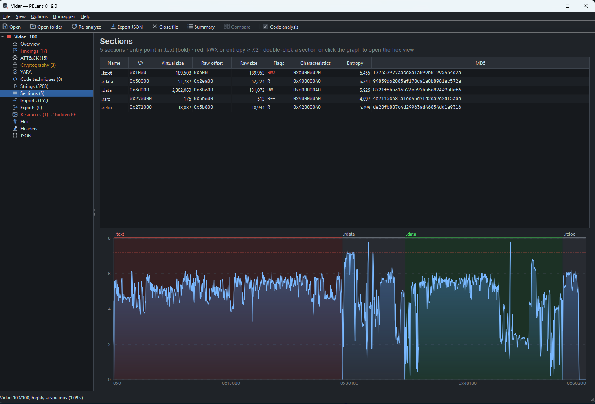
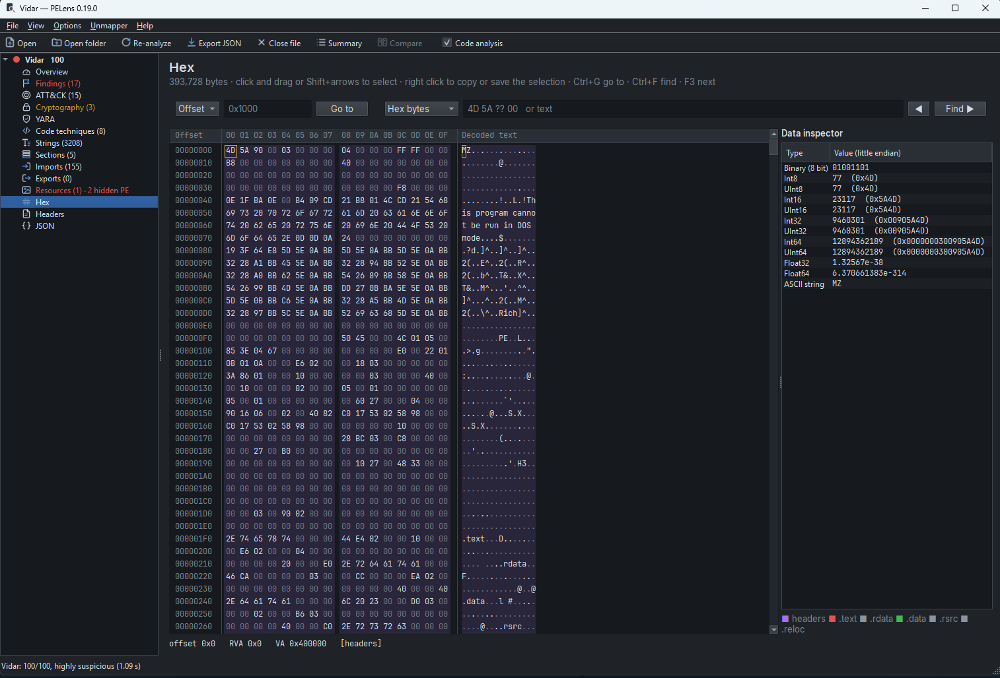
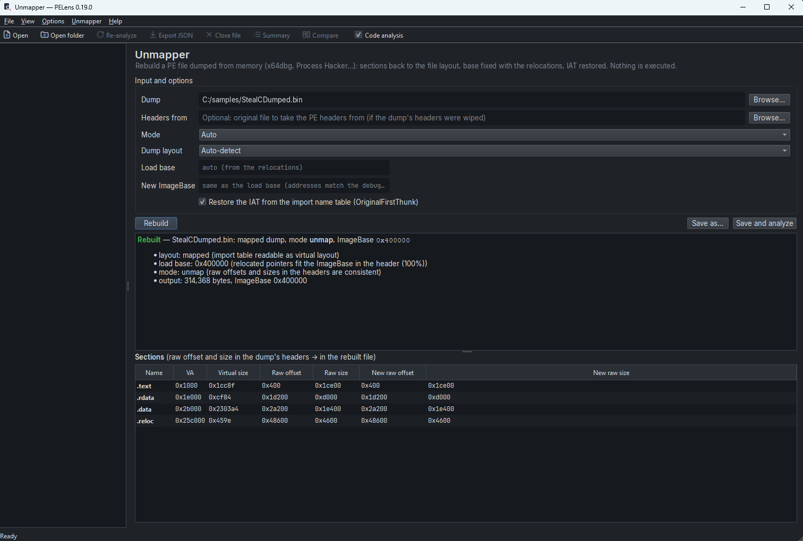

# PELens

**Static PE Analyzer for Malware Triage.** Open an exe or dll and get its structure, what it hides and a
**suspicion score from 0 to 100** with the reasons behind it. Nothing is executed, emulated or decrypted.


## Features

- **PE structure**: headers, sections, imports/exports, resources (with preview), TLS, overlay, protections
  (ASLR, DEP, CFG…), decoded Rich header, verified Authenticode signature
- **Strings** IDA-style, classified (URLs, commands, autorun keys, wallets, anti-VM…), stack strings and Base64
- **Cryptography** recognized without decrypting: AES, ChaCha20, RC4 (custom variants too), DES, Blowfish, TEA,
  hashes, embedded RSA keys, custom Base64, XOR decryption routines
- **Compression and fast hashes**: aPLib, zlib/Deflate, LZMA, LZ4, Zstandard, Windows LZNT1/Xpress APIs;
  MurmurHash2/3, xxHash, SipHash, FNV-1a
- **Loader techniques**: PEB access, API hashing, export parsing, direct syscalls, RWX memory, encrypted payloads
- **Hidden PEs** anywhere in the file, in clear or XOR-encrypted, also inside the pixels of .NET resource images
- **.NET**: APIs by capability, obfuscators, string decryptors in the IL code, steganographic loaders
- **Packers and compilers**: UPX, Themida, VMProtect, NSIS, Inno Setup, Go, Rust, Delphi, PyInstaller…
- **MITRE ATT&CK** techniques for every finding, and your own **YARA** rules
- **Compare two files**: ssdeep of file and sections, imphash, Rich header, imports, resources, Go functions
- **Unmapper**: rebuilds a PE dumped from memory into a file that IDA and PELens read normally
- **HxD-style hex view**, batch analysis of folders with CSV export, JSON and HTML reports
- Rules and signatures in **editable YAML** files

| Sections and entropy | Hex view |
|---|---|
|  |  |
| **Compare two files** | **Unmapper** |
|  |  |

## Download

Get `pelens-gui.exe` (graphical interface) and `pelens.exe` (command line) from the
[Releases](../../releases/latest) page. They are standalone: nothing to install.

> ⚠️ Analyze malware only inside an isolated virtual machine. PELens never runs the file, but samples
> should not live on your own PC.

## Usage

```bash
pelens sample.exe                     # full analysis in the terminal
pelens sample.exe --json report.json  # also save the full report
pelens samples/ -r --csv summary.csv  # a whole folder, with a summary table
pelens --compare a.exe b.exe          # compare two files
pelens dump.bin --unmap fixed.exe     # rebuild a PE dumped from memory
pelens-gui sample.exe                 # graphical interface
```

YARA rules: put them in a `yara` folder next to the exe, or use `--yara <folder>` / *Options → YARA rules folder*.

## From source

```bash
pip install -e ".[gui]"     # Python 3.10+
pelens-gui
```

On Windows, `build_exe.bat` builds the two executables.

## How the score works

Each rule in [`pelens/rules/default.yaml`](pelens/rules/default.yaml) checks one thing and, if it fires, adds its
weight with the evidence that triggered it. Weights and thresholds can be changed and new rules added without
touching the code. The rules were calibrated on legitimate software (7-Zip, Notepad++, Program Files, MinGW, Go and
Rust tools…), which scores almost always between 0 and 20.

The full description of every analysis is in [docs/DETAILS.md](docs/DETAILS.md).

## License

Apache-2.0. Bundled fonts: Inter and JetBrains Mono (SIL Open Font License 1.1).

Made by **FzRsLLaSheR**.
